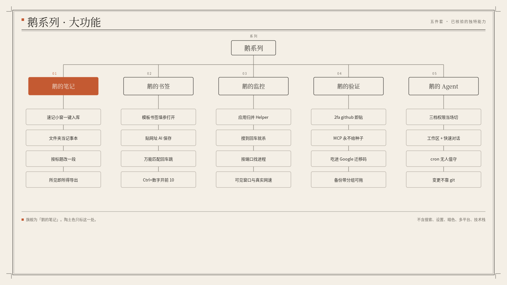

# 鹅的书签

在主框贴网址就能入库。带 `{占位符}` 的书签能当搜索引擎，不是再做一棵浏览器书签树。

## 视频介绍

https://github.com/user-attachments/assets/2ea2aaa0-e03a-4cd8-aa94-794e1d603c0e

### AI 创建

## 大功能

- **模板书签**：URL 里写 `{query}` / `{关键词}`，在 uTools 按 Tab 填参打开。
- **贴网址就保存**：主框贴 http(s)，读网页、润色标题简介并归组。侧栏聊天式 AI 已经拿掉。
- **AI 创建**：开启 AI 后，在主框输入网址或一段含网址的文字，选「AI 创建书签」，自动抓取、译成中文、精简标题描述并归组。
- **万能匹配**：书签可进主输入框；本地搜不到时，回车用当前词跳转。
- **图标落盘与死链**：图标写进本机文件，失败用首字母色块；无效地址本机探测。
- **Ctrl+数字**：按住 Ctrl，当前前 10 个书签出数字，1–9 / 0 直接打开。

## 系列

## 同系列

- [鹅的笔记](https://github.com/eachann1024/goose-notes)
- [鹅的书签](https://github.com/eachann1024/goose-mark)
- [鹅的监控](https://github.com/eachann1024/goose-monitor)
- [鹅的验证](https://github.com/eachann1024/goose-2fa)
- [鹅的 Agent](https://github.com/eachann1024/eachann1024)

## 不做什么

不把书签同步到某家云收藏夹。检测、图标、导入导出都走本机。

## 联网说明

插件界面静态资源全部随包本地加载，不在本地之外拉取第三方 CDN 字体、样式或脚本。以下场景会按需发起网络请求：

- **书签图标与页面信息抓取 / 死链检测**：访问用户添加或检测的目标书签域名（仅限公网 HTTP/HTTPS 地址，禁止内网地址）。
- **AI 创建与润色（可选）**：仅在用户开启 AI 并配置服务后，访问用户指定的模型服务域名。
- **匿名使用统计与反馈（可选）**：可在「隐私与统计」随时关闭，请求域名为 `feedback-api.cooool.top`。

开发说明见 [DEVELOP.md](DEVELOP.md)。

## 许可

本项目以 [MIT 许可证](LICENSE) 开源，版权所有 © 2026 eachann1024。
